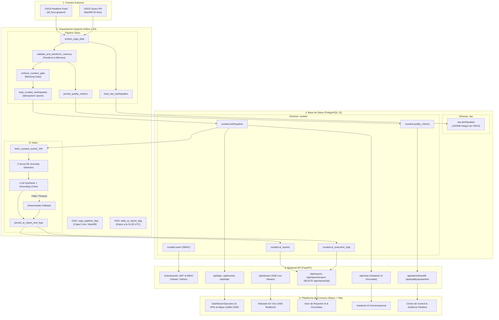

# Arquitectura de la Plataforma SismoWatch
**Sistema Integral de Monitoreo Sísmico Global, Control de Calidad en Memoria y Análisis Ejecutivo con IA**

---

## 1. Propósito de la Arquitectura

### 1.1 Problema que Resuelve
El Servicio Geológico de Estados Unidos (USGS) provee un feed público de actividad sísmica mundial en formato GeoJSON (`all_hour.geojson`). Sin embargo, este feed:
- Es altamente volátil y efímero (cambia cada minuto y no almacena un historial analítico consolidado).
- No valida consistencia geográfica ni integridad de tipos antes de presentarlo al usuario.
- No resume ejecutivamente la actividad ni detecta automáticamente enjambres anómalos.
- No ofrece control de acceso basado en roles (RBAC) ni interfaz de gestión para operaciones críticas.

### 1.2 Para Quién
Diseñado para las áreas de **Operaciones**, **Gestión del Riesgo**, **Continuidad del Negocio** y **Tomadores de Decisiones** de SuperApp a nivel global.

### 1.3 Decisiones que Habilita
- **Priorización de emergencias:** Notificación inmediata ante eventos de magnitud destructiva ($M \ge 6.5$) o alertas de tsunami activas.
- **Detección temprana de enjambres sísmicos:** Identificación estadística mediante Z-Score ($Z \ge 2.0$) de regiones con agrupamientos anómalos.
- **Informes ejecutivos confiables:** Resúmenes diarios automáticos redactados por IA con garantía de cero alucinaciones (cifras ancladas a datos determinísticos).
- **Gobernanza y trazabilidad:** Auditoría de cada lote de datos y registro de consumo de tokens y latencia de IA.

---

## 2. Diagrama de Componentes y Flujo de Datos



---

## 3. Capas de Datos y Decisión Arquitectural

### 3.1 Capa `raw` (PostgreSQL `raw.earthquakes`)
- **Propósito:** Almacena el dato original tal cual llega desde el servicio de USGS en una columna de tipo `JSONB`.
- **Estructura:** `(id PRIMARY KEY, event_time TIMESTAMPTZ, payload JSONB, ingested_at TIMESTAMPTZ)`.
- **Justificación:** Mantiene la inmutabilidad de la fuente. Permite reconstruir cualquier transformación histórica, auditar disputas forenses y probar nuevas reglas sin tener que volver a consumir la API externa de USGS.

### 3.2 Filtrado de Calidad en Memoria (Pandera) & Justificación de Decisión de Negocio
> [!IMPORTANT]
> **RESTRICCIÓN DE NEGOCIO Y DECISIÓN DE ARQUITECTURA / TECH LEAD:**
> No se implementa una tabla de cuarentena física en la base de datos PostgreSQL.

#### Justificación Técnica de la Decisión:
1. **Evitar I/O y degradación de almacenamiento:** En flujos continuos de alta frecuencia (cada 5 minutos, con posibilidad de miles de eventos en réplicas sísmicas), escribir filas corruptas o mal formadas en disco causa fragmentación (*bloat*) de tablas e índices y satura el *Write-Ahead Logging* (WAL) de la base de datos.
2. **Filtrado en Memoria con Pandera:** Las reglas de integridad y tipado (rango de latitud $[-90, 90]$, longitud $[-180, 180]$, profundidad plausible $[-10, 1000]\text{ km}$, unicidad de ID y fechas válidas) son evaluadas estrictamente en la memoria RAM del contenedor de Airflow mediante *Pandera DataFrameSchema*.
3. **Persistencia de Métricas Agregadas (`curated.quality_metrics`):** Los registros inválidos son descartados en memoria, y se registran métricas consolidadas en `curated.quality_metrics`:
   - `total_evaluated`, `total_valid`, `total_discarded`.
   - `quality_score` (porcentaje de calidad).
   - `discard_reasons` (desglose de motivos: coordenadas fuera de rango, IDs duplicados, etc.).
4. **Cero Pérdida de Información:** El dato crudo intacto siempre permanece respaldado en `raw.earthquakes`, permitiendo su inspección o recuperación si se requiere.

### 3.3 Capa `curated` (PostgreSQL `curated.earthquakes`)
- **Propósito:** Almacena los registros aprobados por el motor de calidad, tipados y enriquecidos con la variable geográfica derivada `region`.
- **Idempotencia:** La inserción utiliza la cláusula `ON CONFLICT (id) DO UPDATE SET ...`, asegurando que reejecutar cualquier intervalo temporal jamás duplica eventos y actualiza campos dinámicos (magnitud revisada, estado, tsunami).
- **Indexación:** Índices B-Tree en `event_time DESC`, `magnitude DESC`, `region` y un índice condicional para `tsunami > 0`.

---

## 4. Modelo de Datos Documentado

```mermaid
erDiagram
    RAW_EARTHQUAKES {
        varchar(100) id PK
        timestamptz event_time
        jsonb payload
        timestamptz ingested_at
    }

    CURATED_EARTHQUAKES {
        varchar(100) id PK
        numeric(4,2) magnitude
        varchar(20) mag_type
        text place
        varchar(150) region
        timestamptz event_time
        timestamptz updated_time
        numeric(10,6) longitude
        numeric(10,6) latitude
        numeric(8,2) depth_km
        int tsunami
        int sig
        varchar(50) status
        varchar(50) event_type
        text url
        timestamptz created_at
        timestamptz updated_at
    }

    CURATED_QUALITY_METRICS {
        serial id PK
        varchar(255) dag_run_id
        timestamptz execution_time
        int total_evaluated
        int total_valid
        int total_discarded
        numeric(5,2) quality_score
        jsonb discard_reasons
    }

    CURATED_AI_REPORTS {
        serial id PK
        date report_date UK
        text executive_summary
        jsonb high_activity_zones
        jsonb notable_events
        int total_events
        numeric(4,2) max_magnitude
        numeric(4,2) avg_magnitude
        int tsunami_alerts
        jsonb anomalies_detected
        varchar(50) source
        timestamptz created_at
    }

    CURATED_AI_EXECUTION_LOGS {
        serial id PK
        int report_id FK
        varchar(50) provider
        varchar(100) model
        int prompt_tokens
        int completion_tokens
        int total_tokens
        int latency_ms
        numeric(8,6) estimated_cost_usd
        varchar(50) status
        timestamptz created_at
    }

    CURATED_USERS {
        serial id PK
        varchar(50) username UK
        varchar(255) hashed_password
        varchar(20) role
        timestamptz created_at
    }

    CURATED_AI_REPORTS ||--o{ CURATED_AI_EXECUTION_LOGS : "logs telemetry"
```

---

## 5. IA y Analítica Avanzada

### 5.1 Detección de Anomalías Analítica / ML (Algoritmo Z-Score)
Para detectar enjambres sísmicos inusuales sin depender de cajas negras, se calcula el Z-Score sobre la frecuencia regional de sismos en la ventana de 24 horas:

$$Z = \frac{X - \mu}{\sigma}$$

Donde:
- $X$ es el número de eventos en una región particular.
- $\mu$ es la media regional global.
- $\sigma$ es la desviación estándar regional.

Si $Z \ge 2.0$, se genera una alerta estadística estructurada clasificada por severidad:
- **MEDIUM:** $2.0 \le Z < 2.5$
- **HIGH:** $2.5 \le Z < 3.5$
- **CRITICAL:** $Z \ge 3.5$

### 5.2 Resumen Ejecutivo con LLM y Guardrails Anti-Alucinación
1. **Cálculo Determinístico Previo:** El código Python calcula de forma exacta: total de eventos, magnitud máxima, promedio, alertas de tsunami y enjambres.
2. **Prompt Versionado (`v1.2.0`):** Se inyectan las métricas factibles en el prompt del sistema y de usuario, instruyendo explícitamente al LLM a no calcular ni inventar datos.
3. **Verificación de Grounding:** Una función de verificación comprueba que las cifras redactadas coincidan con los números calculados.
4. **Plan Alterno (Deterministic Fallback):** Si el LLM falla, excede el timeout de 15 segundos o alucina una cifra, el sistema activa inmediatamente el generador estructurado de respaldo, garantizando que el pipeline nunca se detenga.
5. **Observabilidad:** Cada ejecución registra proveedor (`gemini`, `openai`), modelo, tokens consumidos, latencia en ms y costo estimado en dólares en la tabla `curated.ai_execution_logs`.

---

## 6. Seguridad y Control de Acceso

### 6.1 Mínimo Privilegio en PostgreSQL
- **`airflow_role`:** Cuenta con permisos completos (`USAGE`, `SELECT`, `INSERT`, `UPDATE`) sobre los schemas `raw` y `curated`.
- **`api_role` (usuario `sismowatch_api`):** Estrictamente de **solo lectura** (`SELECT`) sobre el schema `curated`. Tiene **revocado todo acceso** al schema `raw`. La plataforma web jamás puede consultar `raw` ni modificar registros.

### 6.2 Autenticación y Autorización en Plataforma (RBAC)
- **Tokens JWT:** Firmados con HMAC-SHA256 y expiración configurable.
- **Roles:**
  - `viewer`: Puede consultar el Dashboard (KPIs, mapa, gráficos), eventos en tiempo real, historial de reportes y exportar CSV/HTML.
  - `admin`: Tiene permisos exclusivos para lanzar backfills históricos (`/api/admin/backfill`), regenerar reportes de IA (`/api/admin/reports/regenerate`) y consultar la auditoría de descartes en memoria (`/api/quality/quarantine`).
- **Respuesta ante falta de privilegios:** Cualquier usuario con rol `viewer` que intente invocar un endpoint administrativo recibe un error explícito `403 Forbidden` (`detail: "Acceso denegado: Esta acción requiere permisos de Administrador"`).

### 6.3 Sanitización contra Prompt Injection y XSS
El campo geográfico `place` recibido de la API pública es sanitizado mediante expresiones regulares para eliminar patrones como `system:`, `ignore previous instructions`, etiquetas XML/HTML y caracteres de escape antes de ser procesado o enviado a un LLM.

---

## 7. Decisiones Técnicas y Trade-offs

| Componente | Opción Elegida | Alternativa Descartada | Justificación y Trade-off |
|---|---|---|---|
| **Orquestador** | Apache Airflow 2.10 | Cron de Linux / Scripts sueltos | Airflow provee observabilidad gráfica, dependencias explícitas en grafo (DAG), reintentos automáticos con retroceso exponencial, ejecución parametrizada para backfills y manejo unificado de secretos. Un Cron carece de interfaz, reintentos controlados y linaje de datos. |
| **Calidad de Datos** | Pandera (en memoria) | Tabla física de Cuarentena en DB | La decisión del TL descarta la tabla física para evitar saturar el disco y el WAL con datos descartados. Pandera ofrece validación tipada basada en esquemas de DataFrames con alto rendimiento en memoria. |
| **Backend API** | FastAPI | Flask / Django | FastAPI es asíncrono nativo (soporta SSE eficientemente para streaming en tiempo real), ofrece documentación automática interactiva en `/docs` y validación de tipos estricta con Pydantic v2. |
| **Frontend** | React + Vite + TypeScript | Dashboard BI (Metabase / Grafana) | Aunque Metabase o Grafana permiten gráficos rápidos, no permiten el control fino de roles (RBAC) con bloqueo de botones a nivel de token, ni la integración directa con eventos Server-Sent Events (SSE) ni la ejecución de backfills parametrizados. |

---

## 8. Qué Haríamos Diferente en un Entorno de Producción a Gran Escala

Si SismoWatch escalara a decenas de miles de eventos por segundo o fuentes sísmicas globales múltiples:
1. **Streaming con Apache Kafka y Apache Flink:** Reemplazar el *polling* de 5 minutos por una arquitectura orientada a eventos (*Event-Driven Architecture*) donde los sensores sísmicos publiquen en un tópico Kafka y Flink ejecute el filtrado de calidad y cálculo de ventanas deslizantes en tiempo real sub-segundo.
2. **Lakehouse Distribuido (Apache Iceberg sobre AWS S3):** La capa `raw` se guardaría como archivos Parquet optimizados en S3 con metadatos Iceberg, reduciendo costos de almacenamiento en PostgreSQL a una fracción mínima.
3. **Airflow KubernetesExecutor:** Desplegar Airflow en Kubernetes (EKS o GKE) con `KubernetesExecutor` para que cada tarea de ingesta o backfill corra en un Pod aislado y efímero que se destruye tras finalizar.
4. **Almacén Analítico Columnar:** Reemplazar las consultas agregadas de PostgreSQL por una base de datos columnar como **ClickHouse** o **Snowflake**, capaz de responder consultas de KPIs sobre millones de sismos en milisegundos.
